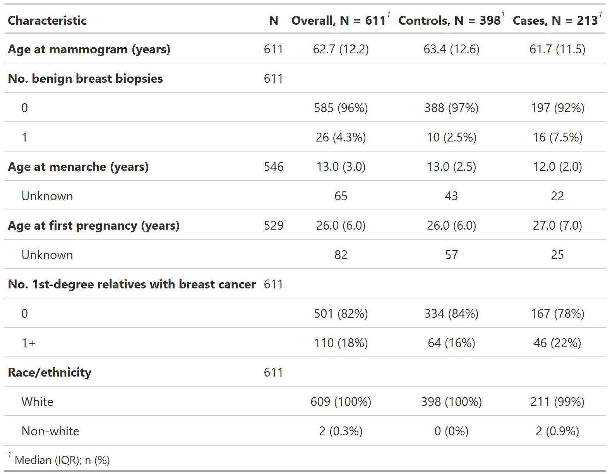

# Mammography Risk Prediction

## Setup
* Have received digital mammograms from a subset of the Generations Study (GS).
* MIRAI takes as input digital mammograms and outputs a 1-, 2-, 3-, 4-, and 5-year risk.
* Objective is to compare the discrimination of MIRAI with standard breast density measures (Cumulus), as well as a standard risk model using risk factor information (GAIL).

## Study Population
* Subset of GS that has a valid mammography study. The criteria for a valid mammography study are:
	* Processed digital mammograms for all 4 standard views (LMLO, LCC, RCC, RMLO)
	* No prior history of breast cancer
	* Participant does not die in the year proceeding the mammography study
	* Mammography study was conducted before the end of follow up 
* If a mammography study had more than one mammographic image of the same view, only one was kept with random selection.
* Per participant, the latest mammography study performed more than one year before the date of diagnosis was selected.

## Plan of Analysis
* Risk scores
	* MIRAI scores calculated using latest valid mammography study as described above. The score for a 5-year risk will be used in discrimination analysis
	* Calculate GAIL scores using data up to the date of the mammogram
	* Use Cumulus scores from the date of the mammogram used to calculate MIRAI scores
	* As an estimate of the Mirai risk score excluding density information, the residuals were taken from a model fitting Cumulus readings onto Mirai 5yr risk
* Discrimination analysis
	* To evaluate discrimination of the scores, we will calculate the concordance index (C-index) of the scores with right-censoring at 5 years, end of follow-up, or at event, whichever comes first.
* Correlation with known risk factors
	* We assessed the association between MIRAI 5-year risk scores and established breast cancer risk factors using linear models.
	* Risk factors included:
		- Age at mammography study
		- Cumulus density reading
		- History of atypical hyperplasia (No, Yes)
		- Number of breast biopsies with benign findings
		- Age at menarche
		- Age at first pregnancy
		- Number of first-degree relatives with breast cancer
		- Race (White, African-American, Hispanic American, Other (Native American and Unknown), Hispanic American (Foreign-born), Chinese-American, Japanese-American, Filipino-American, Hawaiian-American, Other Pacific Islander, Other Asian)
		
## Data description
 ### Baseline characteristics
 

 ### Risk factor distributions
 
	
## Results
1. Discrimination performance
	* 615 eligible participants
		* 611 were available for analysis (4 excluded due to corrupted dicom or opt-out)
	
	### A. Complete Case Analysis (n = 611)

	| Score           | C-index                        |
	|----------------|---------------------------------|
	| GAIL           | 0.539 (0.498 – 0.579)           |
	| Mirai (5-year) | 0.655 (0.620 – 0.690)           |

	### B. Subset with Cumulus Reading (n = 188)

	| Score           | C-index                        |
	|----------------|---------------------------------|
	| Cumulus        | 0.541 (0.472 – 0.610)           |
	| GAIL           | 0.529 (0.462 – 0.593)           |
	| Mirai (5-year) | 0.630 (0.566 – 0.693)           |
	
2. Correlation with Risk Factors
	### Univariable: Associations with MIRAI 5-year risk score (controls only):
	
	| Variable        | p-value |
	|-----------------|---------|
	| T1              | 0.0170  |
	| N_Biop          | 0.285   |
	| AgeMen          | 0.578   |
	| Age1st          | 0.328   |
	| N_Rels          | 0.154   |
	| cumulus_reading | 0.00316 |

	### Multivariable: Associations with MIRAI 5-year risk score (controls only):
	
	| Variable            | p-value |
	|---------------------|---------|
	| T1                  | 0.0199  |
	| N_Biop1             | 0.1737  |
	| AgeMen              | 0.8225  |
	| Age1st              | 0.2096  |
	| N_Rels              | 0.1067  |
	| cumulus_reading     | 0.0105  |
	| T1_NA               | NA      |
	| AgeMen_NA           | 0.6930  |
	| Age1st_NA           | 0.1924  |
	| N_Rels_NA           | NA      |
	| cumulus_reading_NA  | 0.0046  |
