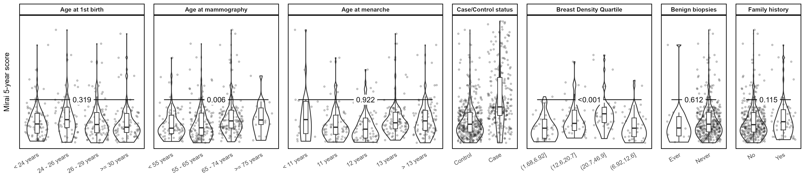

# Mammography Risk Prediction

## Setup
* Have received digital mammograms from a subset of the Generations Study (GS).
* MIRAI takes as input digital mammograms and outputs a 1-, 2-, 3-, 4-, and 5-year risk.
* Objective is to compare the discrimination of MIRAI with standard breast density measures (Cumulus), as well as a standard risk model using risk factor information (GAIL).

## Study Population
* Subset of GS that has a valid mammography study. The criteria for a valid mammography study are:
	* Processed digital mammograms for all 4 standard views (LMLO, LCC, RCC, RMLO)
	* No prior history of breast cancer
	* Participant does not die in the year proceeding the mammography study
	* Mammography study was conducted before the end of follow up 
* If a mammography study had more than one mammographic image of the same view, only one was kept with random selection.
* Per participant, the latest mammography study performed more than one year before the date of diagnosis was selected.

## Plan of Analysis
* Risk scores
	* MIRAI scores calculated using latest valid mammography study as described above. The score for a 5-year risk will be used in discrimination analysis
	* Calculate GAIL scores using data up to the date of the mammogram
	* Use Cumulus scores from the date of the mammogram used to calculate MIRAI scores
	* As an estimate of the Mirai risk score excluding density information, the residuals were taken from a model fitting Cumulus readings onto Mirai 5yr risk
* Discrimination analysis
	* To evaluate discrimination of the scores, we will calculate the concordance index (C-index) of the scores with right-censoring at 5 years, end of follow-up, or at event, whichever comes first.
* Correlation with known risk factors
	* We assessed the association between MIRAI 5-year risk scores and established breast cancer risk factors using linear models.
	* Risk factors included:
		- Age at mammography study
		- Cumulus density reading
		- History of atypical hyperplasia (No, Yes); not available within GS
		- Number of breast biopsies with benign findings
		- Age at menarche
		- Age at first pregnancy
		- Number of first-degree relatives with breast cancer
		- Race (White, African-American, Hispanic American, Other (Native American and Unknown), Hispanic American (Foreign-born), Chinese-American, Japanese-American, Filipino-American, Hawaiian-American, Other Pacific Islander, Other Asian)
		
## Data description
 ### Baseline characteristics
  The baseline characteristics (Table 1) can be found [here](results/tables/table_1.docx)

 ### Risk factor distributions
 Distributions of risk factors are shown among **controls only**, except for *case/control status* which is shown across the full study population.
 
 
	
## Results
Associations between the Mirai risk score and risk factors can be found [here](results/tables/table_2.docx).

Discriminatory performance of Mirai, Gail, and Cumulus can be found [here](results/tables/table_3.docx).

Ensemble discriminatory performance of Mirai, Gail, and Cumulus can be found [here](results/tables/table_4.docx).
