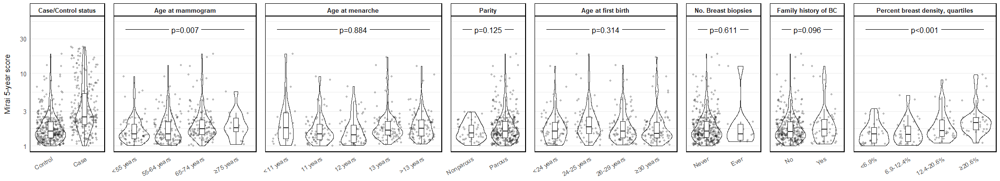

# Mammography AI Breast Cancer Risk Stratification in a UK Population

<a href="https://github.com/UK-Generations-Study/mammo-risk-prediction/blob/main/README.md">← Back to repository README</a>

## Analysis

### Figure 1

Violin plots of risk factors and Mirai

### Table 1

Descriptive table of the study population for the variables included in
the GAIL model

| **Characteristic** | **Controls, N = 369** | **Cases, N = 241** |
|:---|:--:|:--:|
| **Age at mammogram (years), Median (IQR)** | 63.6 (56.3-68.7) | 61.1 (54.9-65.9) |
| **Mammography device used** |  |  |
| Lorad Selenia | 228 (62%) | 168 (70%) |
| Selenia Dimensions | 141 (38%) | 73 (30%) |
| **Race/ethnicity** |  |  |
| White | 365 (99%) | 238 (99%) |
| Non-white | 4 (1.1%) | 3 (1.2%) |
| **Age at menarche (years), Median (IQR)** | 13.0 (11.0-14.0) | 12.0 (11.0-13.0) |
| Unknown | 40 | 27 |
| **Age at first live birth (years)** |  |  |
| 24-25 | 65 (18%) | 38 (16%) |
| 26-29 | 83 (23%) | 45 (19%) |
| 30+ | 94 (26%) | 84 (35%) |
| \<24 | 78 (21%) | 42 (18%) |
| Nulliparous | 45 (12%) | 30 (13%) |
| Unknown | 4 | 2 |
| **No. benign breast biopsies** |  |  |
| 0 | 359 (97%) | 225 (93%) |
| 1+ | 10 (2.7%) | 16 (6.6%) |
| **No. 1st-degree relatives with breast cancer** |  |  |
| 0 | 314 (85%) | 186 (77%) |
| 1+ | 55 (15%) | 55 (23%) |
| **Mirai 5-year absolute risk (%), Median (IQR)** | 1.6 (1.3-2.2) | 2.5 (2.0-5.3) |
| **Gail 5-year absolute risk (%), Median (IQR)** | 1.7 (1.4-2.0) | 1.7 (1.4-2.2) |
| **Percent breast density (%), Median (IQR)** | 12.4 (6.9-20.8) | 16.1 (8.8-23.9) |
| Unknown | 226 | 147 |
| **Age at BC diagnosis (years), Median (IQR)** | \- | 64.1 (57.9-69.1) |
| **Time from mammogram to BC diagnosis (years), Median (IQR)** | \- | 2.9 (2.1-3.1) |
| **Cancer type** |  |  |
| Invasive | \- | 189 (78%) |
| DCIS | \- | 52 (22%) |
| **ER status** |  |  |
| Positive | \- | 138 (80%) |
| Negative | \- | 34 (20%) |
| Unknown | 0 | 69 |

### Table 2

| Model | Cases/Controls | Mirai | Gail | PD | AUC (95% CI) | Calibration Slope (95% CI) |
|:---|:---|:---|:---|:---|:---|:---|
| Model 1 | 241/369 | 2.84 (2.39, 3.12) | \- | \- | 0.74 (0.72, 0.76) | 1.75 (1.31, 2.24) |
| Model 2 | 241/369 | \- | 1.30 (1.16, 1.45) | \- | 0.56 (0.54, 0.59) | 1.24 (0.51, 2.01) |
| Model 4 | 241/369 | 2.81 (2.39, 3.07) | 1.22 (1.15, 1.38) | \- | 0.74 (0.72, 0.77) | \- |
| Model 1 | 94/143 | 2.20 (1.68, 2.86) | \- | \- | 0.68 (0.60, 0.72) | 1.19 (0.22, 2.37) |
| Model 2 | 94/143 | \- | 1.27 (1.05, 1.62) | \- | 0.56 (0.46, 0.63) | \- |
| Model 3 | 94/143 | \- | \- | 1.12 (1.00, 1.32) | 0.56 (0.49, 0.62) | \- |
| Model 4 | 94/143 | 2.22 (1.69, 2.86) | 1.29 (1.07, 1.72) | \- | 0.66 (0.60, 0.72) | \- |
| Model 5 | 94/143 | 2.16 (1.69, 2.65) | \- | 1.04 (0.91, 1.21) | 0.67 (0.56, 0.71) | \- |
| Model 6 | 94/143 | \- | 1.26 (1.04, 1.62) | 1.11 (0.99, 1.27) | 0.56 (0.47, 0.64) | \- |
| Model 7 | 94/143 | 2.20 (1.71, 2.71) | 1.28 (1.05, 1.71) | 1.02 (0.91, 1.15) | 0.65 (0.60, 0.71) | \- |

## Supplementary Material

### Supplementary Table 1

Correlations of the MIRAI score with variables included in the GAIL
model as well as mammographic density

| **Risk Factor** | **Univariable Beta (95% CI)** | **Univariable P Value** | **Multivariable Beta (95% CI)** | **Multivariable P Value** |
|:---|:--:|:--:|:--:|:--:|
| Age at mammogram (years) | 0.01 (0.00, 0.02) | 0.008 | 0.01 (0.00, 0.02) | 0.007 |
| No. breast biopsies | -0.00 (-0.32, 0.31) | 0.977 | -0.08 (-0.39, 0.23) | 0.611 |
| Age at menarche (years) | 0.01 (-0.03, 0.05) | 0.643 | 0.00 (-0.03, 0.04) | 0.884 |
| Parity | 0.12 (-0.03, 0.28) | 0.129 | 0.25 (-0.07, 0.58) | 0.125 |
| Age at first birth (years) | -0.00 (-0.01, 0.01) | 0.512 | -0.01 (-0.02, 0.01) | 0.314 |
| Family history of BC | 0.13 (-0.02, 0.27) | 0.083 | 0.12 (-0.02, 0.26) | 0.096 |
| Percent breast density | 0.01 (0.01, 0.02) | \<0.001 | 0.02 (0.01, 0.02) | \<0.001 |

### Supplementary Table 2

| **Characteristic** | **N** | **Controls, N = 369** | **Cases, N = 241** |
|:---|:--:|:--:|:--:|
| **Time from mammogram to BC diagnosis (years)** | 610 |  |  |
| \<=5 years |  | 8 (2.2%) | 221 (92%) |
| \>5 years |  | 5 (1.4%) | 20 (8.3%) |
| Control |  | 356 (96%) | 0 (0%) |

### Supplementary Table 3

| years | GAIL              | Mirai             |
|:------|:------------------|:------------------|
| 1     | 0.58 (0.53, 0.62) | 0.76 (0.72, 0.80) |
| 2     | 0.57 (0.53, 0.62) | 0.76 (0.72, 0.80) |
| 3     | 0.57 (0.52, 0.62) | 0.76 (0.72, 0.79) |
| 4     | 0.57 (0.52, 0.61) | 0.75 (0.71, 0.79) |
| 5     | 0.57 (0.52, 0.61) | 0.75 (0.71, 0.79) |
